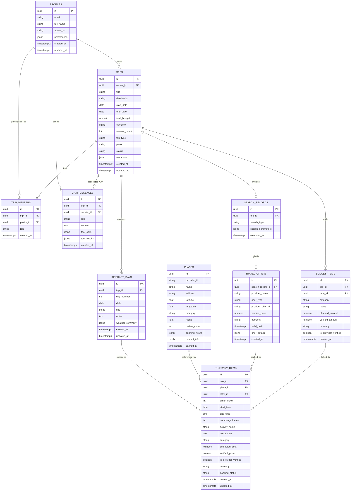

# Travio AI: Architecture, Database Design & Roadmap

Travio AI is a production-oriented AI travel-planning mobile application built as a **modular monolith** with a **React Native (Expo + TypeScript)** frontend and a **FastAPI + LangGraph + PostgreSQL** backend.

---

## 1. System Architecture (Modular Monolith)

```mermaid
graph TB
    subgraph ClientLayer ["Mobile Client (React Native + Expo Router)"]
        UI["Expo Screens & Components"]
        AuthHook["useAuth (Supabase Session)"]
        HTTPClient["API Client (Axios + Auto Bearer JWT)"]
        MapViewComp["Interactive Maps (react-native-maps)"]
        LocalCache["AsyncStorage / SecureStore"]
    end

    subgraph BackendGateway ["FastAPI Modular Monolith"]
        subgraph APILayer ["API Layer (Routers & Contracts)"]
            V1Router["/api/v1 Router"]
            HealthAPI["Health Router (/api/v1/health)"]
            AuthAPI["Profiles Router (/api/v1/profiles)"]
            TripsAPI["Trips Router (/api/v1/trips)"]
            ItineraryAPI["Itinerary Router (/api/v1/trips/{id}/itinerary)"]
            PlacesAPI["Places Router (/api/v1/places)"]
            OffersAPI["Offers Router (/api/v1/offers)"]
            ChatWorkflowAPI["Chat Router (/api/v1/chat)"]
        end

        subgraph SecurityLayer ["Security & Auth Middleware"]
            JWTMiddleware["Supabase JWT Verification (Signature, ISS, AUD, Exp)"]
            RBACGuard["Trip Ownership & Membership Guard (OWNER, EDITOR, VIEWER)"]
            RateLimiter["SlowAPI Rate Limiter"]
        end

        subgraph ServiceLayer ["Application Services"]
            TripService["Trip Service (CRUD, Membership)"]
            ItineraryService["Itinerary Service (Ordering, Conflict Checks)"]
            BudgetEngine["Deterministic Budget Engine (Pure Python)"]
            ScheduleEngine["Deterministic Schedule Validator"]
            WorkflowService["Planning Orchestrator Service"]
        end

        subgraph WorkflowEngine ["Typed LangGraph Workflow Engine"]
            StateGraph["StateGraph (TypedDict / Pydantic)"]
            IntentParserNode["Request Parsing Node"]
            CoordinatorNode["Coordinator & Task Decomposer"]
            RetrievalNode["Provider Retrieval Node"]
            SynthesisNode["Structured Itinerary Synthesis Node"]
            DeterministicValidationNode["Deterministic Validation Node"]
            RevisionNode["Conditional Revision Node (Max Loops = 3)"]
            Checkpointer["PostgresSaver Checkpointer"]
        end

        subgraph RepositoryLayer ["Data Access & Repositories"]
            ProfileRepo["Profile Repository"]
            TripRepo["Trip Repository"]
            ItineraryRepo["Itinerary Repository"]
            PlaceRepo["Place Repository"]
            OfferRepo["Travel Offer Repository"]
            ChatRepo["Chat Message Repository"]
        end

        subgraph ProviderAdapters ["External Provider Adapters (Normalized & Resilient)"]
            PlacesAdapter["Places Adapter (Geoapify)"]
            RoutingAdapter["Routing Adapter (OSRM)"]
            WeatherAdapter["Weather Adapter (Open-Meteo)"]
            FlightHotelAdapter["Flight & Hotel Adapter (Amadeus)"]
            CircuitBreaker["Timeout & Fallback Handler"]
        end
    end

    subgraph DataStorage ["Persistence Layer"]
        PostgresDB[("PostgreSQL Database (SQLAlchemy + Alembic)")]
    end

    %% Flow connections
    UI --> AuthHook
    UI --> HTTPClient
    UI --> MapViewComp
    HTTPClient -->|Bearer JWT| V1Router

    V1Router --> JWTMiddleware
    JWTMiddleware --> RBACGuard

    HealthAPI --> V1Router
    AuthAPI --> TripService
    TripsAPI --> TripService
    ItineraryAPI --> ItineraryService
    PlacesAPI --> PlacesAdapter
    OffersAPI --> FlightHotelAdapter
    ChatWorkflowAPI --> WorkflowService

    WorkflowService --> StateGraph
    StateGraph --> IntentParserNode
    IntentParserNode --> CoordinatorNode
    CoordinatorNode --> RetrievalNode
    RetrievalNode --> CircuitBreaker
    CircuitBreaker --> PlacesAdapter
    CircuitBreaker --> WeatherAdapter
    CircuitBreaker --> FlightHotelAdapter
    CircuitBreaker --> RoutingAdapter
    RetrievalNode --> SynthesisNode
    SynthesisNode --> DeterministicValidationNode
    DeterministicValidationNode --> BudgetEngine
    DeterministicValidationNode --> ScheduleEngine
    DeterministicValidationNode -->|Validation Failed| RevisionNode
    RevisionNode --> CoordinatorNode
    DeterministicValidationNode -->|Passed or Final| ServiceLayer
    StateGraph -.-> Checkpointer

    TripService --> TripRepo
    ItineraryService --> ItineraryRepo
    TripService --> BudgetEngine
    TripRepo --> PostgresDB
    ItineraryRepo --> PostgresDB
    ProfileRepo --> PostgresDB
    PlaceRepo --> PostgresDB
    OfferRepo --> PostgresDB
    ChatRepo --> PostgresDB
    Checkpointer --> PostgresDB
```

---

## 2. Database Relationship Diagram (PostgreSQL)

---

## 3. Clear Ownership, Membership & Price Separation Rules

### Trip Ownership & Roles
- Every trip has an `owner_id` (foreign key to `PROFILES.id`).
- When a trip is created, a row is automatically inserted into `TRIP_MEMBERS` with `role = 'OWNER'`.
- Allowed roles:
  - `OWNER`: Full read, edit, delete, invite members, change roles.
  - `EDITOR`: Read, edit itinerary items, add budget items, run chat planning.
  - `VIEWER`: Read-only access to trip, itinerary, budget, and map.
- The `TripOwnershipGuard` FastApi dependency validates these permissions before allowing any operation.

### Estimated vs. Verified Prices
- `estimated_cost`: AI or heuristic estimation (e.g. typical museum ticket, lunch budget).
- `verified_price`: Authoritative, live provider offer price (e.g. exact Amadeus flight quote or confirmed hotel reservation).
- `is_provider_verified`: Boolean flag strictly set to `True` only when linked to a valid `TRAVEL_OFFERS` record.

### Primary Provider Adapters (Initial Baseline)
- **Places & POIs**: Geoapify Places API (with fallback to OpenStreetMap / Nominatim)
- **Routing & Travel Duration**: OSRM (Open Source Routing Machine API)
- **Weather Forecast**: Open-Meteo API (free, reliable, requires no API key)
- **Flights & Hotels**: Amadeus API (with mock/sandbox fallback during local development)
